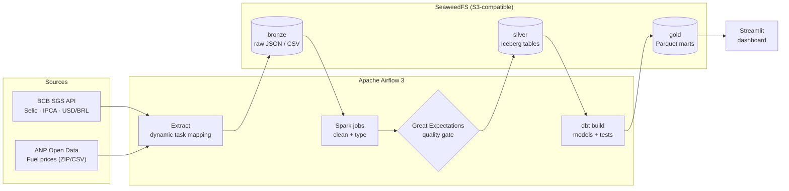
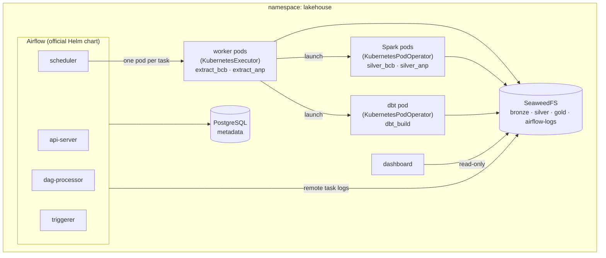

# 🇧🇷 Brazil Economic Data Lakehouse

🇧🇷 [Versão em português](README.md)


An end-to-end batch data platform that ingests Brazilian economic indicators and fuel prices from public sources, organizes them in a **medallion architecture** (bronze → silver → gold) on an S3-compatible data lake, processes them with **Apache Spark** into **Apache Iceberg** tables guarded by **Great Expectations** quality gates, models analytics-ready tables with **dbt**, and serves them in a **Streamlit** dashboard. Everything is orchestrated by **Apache Airflow** and runs either with **Docker Compose** or on **Kubernetes** (official Helm chart, one pod per task).


## Business question

> How have fuel prices in Brazil evolved compared to inflation (IPCA), the US dollar exchange rate and the Selic interest rate?

The final mart indexes every metric to 100 at the first month of the period, which makes it easy to see whether fuel became more expensive in real terms or simply followed inflation and the dollar.

## Key insights

January 2018 to June 2026, national averages from **7.4 million** price observations collected by ANP:

| Product | Jan 2018 | Jun 2026 | Nominal change | Real change (deflated by IPCA) |
|---|---|---|---|---|
| Diesel S10 | R$ 3.49 / l | R$ 7.12 / l | +104.1% | **+32.3%** |
| Diesel | R$ 3.39 / l | R$ 6.87 / l | +102.5% | +31.3% |
| CNG | R$ 2.48 / m³ | R$ 4.67 / m³ | +88.1% | +22.0% |
| Gasoline | R$ 4.22 / l | R$ 6.66 / l | +57.7% | +2.3% |
| Ethanol | R$ 3.14 / l | R$ 4.45 / l | +41.4% | **−8.3%** |
| Premium gasoline¹ | R$ 4.55 / l | R$ 6.86 / l | +50.8% | +7.2% |

¹ ANP only reports premium gasoline from October 2020, so its comparison starts there.

Inflation (IPCA) accumulated +54.2% and the dollar +59.7% over the same period.

- **Diesel doubled and became about 31% more expensive in real terms**, tracking the dollar (+59.7%) more closely than inflation.
- **Gasoline roughly followed inflation** over the whole period (+2.3% in real terms), but the path was anything but flat: from R$ 3.85 in May 2020, at the low point of the pandemic, to R$ 7.29 in May 2022.
- **Ethanol is the only fuel that got cheaper in real terms.**
- **Regional spread is large**: in June 2026 gasoline cost R$ 7.68 in Roraima and R$ 6.36 in Minas Gerais (+21%); ethanol ranged from R$ 3.86 (Mato Grosso) to R$ 5.89 (Amapá).

## Architecture



## Tech stack

| Layer | Technology |
|---|---|
| Orchestration | Apache Airflow 3.3 (TaskFlow API; LocalExecutor on Compose, KubernetesExecutor on Kubernetes) |
| Ingestion | Python 3.12, Requests, boto3 |
| Transformation (bronze → silver) | Apache Spark 4.1 (PySpark) |
| Data lake | SeaweedFS (S3 API), Apache Iceberg 1.12 |
| Analytics engineering | dbt-core + dbt-duckdb (DuckDB reads Iceberg, marts exported as Parquet) |
| Data quality | Great Expectations (blocking gate before silver), dbt tests |
| Visualization | Streamlit + Altair |
| Infrastructure | Docker Compose; Kubernetes (kind), official Airflow Helm chart, Kustomize |
| CI | GitHub Actions: Ruff, pytest, Spark tests on Java 17, dbt parse, Kubernetes manifest rendering |

## Data sources

| Source | Dataset | Frequency | Access |
|---|---|---|---|
| [Banco Central do Brasil — SGS](https://dadosabertos.bcb.gov.br/) | Selic target rate (series 432) | Daily | Public REST API |
| [Banco Central do Brasil — SGS](https://dadosabertos.bcb.gov.br/) | IPCA monthly inflation (series 433) | Monthly | Public REST API |
| [Banco Central do Brasil — SGS](https://dadosabertos.bcb.gov.br/) | USD/BRL exchange rate (series 1) | Daily | Public REST API |
| [ANP — Série Histórica de Preços de Combustíveis](https://www.gov.br/anp/pt-br/centrais-de-conteudo/dados-abertos/serie-historica-de-precos-de-combustiveis) | Fuel prices collected at gas stations | Semiannual files | Public ZIP / CSV |

No API keys are required.

## Data layers

| Layer | Storage | Content |
|---|---|---|
| **Bronze** | `s3://bronze/` | Raw data as received, partitioned by source and ingestion period: JSON from BCB, and the ANP CSV byte for byte, gzip-compressed (ANP publishes ZIP archives, which Spark cannot read) |
| **Silver** | `s3://silver/warehouse/` | Cleaned, typed and deduplicated Iceberg tables, written by Spark only after passing the quality gate |
| **Gold** | `s3://gold/marts/` | dbt marts exported as Parquet, read by the dashboard. Staging and intermediate models live in DuckDB |

### Silver tables (Iceberg)

| Table | Partitioning | Written by |
|---|---|---|
| `lake.bcb.series` | `series_name` | `lakehouse.spark.bcb_silver` (latest bronze snapshot of each series) |
| `lake.anp.fuel_prices` | `period_year`, `period_semester` | `lakehouse.spark.anp_silver` (one partition per semiannual bronze file) |

Both tables carry lineage columns: `_source_file` (the bronze object a row came from) and `_ingested_at`.

### Data quality

Quality is checked at two points:

1. **Before silver (Great Expectations, blocking).** Each Spark job validates its DataFrame before writing. If any expectation fails, the task fails and nothing is written, so bad data never reaches silver. Checks include row counts, not-null keys, valid Brazilian state codes, CNPJ length, uniqueness of dates per BCB series, and plausible value ranges (for example USD/BRL between 0.5 and 20, fuel prices between R$ 0.50 and R$ 50).
2. **In gold (dbt tests).** dbt checks uniqueness, not-null columns, accepted values and price bounds on the models.

### Gold models

| Model | Grain | Description |
|---|---|---|
| `staging.stg_bcb__series` | series × date | Standardized BCB time series |
| `staging.stg_anp__fuel_prices` | price observation | Standardized ANP price observations |
| `intermediate.int_macro_indicators_monthly` | month | Selic, IPCA and USD/BRL pivoted to a monthly grain |
| `marts.fct_fuel_prices_monthly` | month × state × product | Average, median, min and max fuel prices |
| `marts.mart_fuel_vs_macro` | month × product | National fuel prices vs. macro indicators, indexed to 100, plus inflation-adjusted price |

## Pipeline

The `economic_lakehouse` DAG runs weekly:

```
list_bcb_series ──► extract_bcb[n] ──► silver_bcb (Spark) ──┐
                                                            ├──► dbt_build
list_anp_periods ─► extract_anp[n] ──► silver_anp (Spark) ──┘
```

- **Dynamic task mapping** creates one extraction task per BCB series and one per ANP semester.
- **Idempotent by design**: ANP files already in bronze are not downloaded again. Spark only processes semesters that are not in silver yet (it checks Iceberg partition metadata, not the data files), and it writes with dynamic partition overwrite, so a rerun replaces its own partitions instead of duplicating rows. Enable the `full_refresh` parameter to rebuild every partition.
- **One DAG, two runtimes**: on Docker Compose, Spark and dbt run inside the Airflow worker (`BashOperator`, local Spark, a single-slot pool to bound memory). On Kubernetes (`LAKEHOUSE_RUNTIME=kubernetes`) they run as pods from their own images (`KubernetesPodOperator`), with memory requests and limits.
- **Graceful handling of unpublished data**: if the ANP file for the current semester is not available yet, the task is *skipped* instead of failing, and `dbt_build` still runs (`trigger_rule="none_failed"`).
- **Retries** with backoff at both the HTTP client and the Airflow task level.

## Dashboard

The Streamlit app (in Brazilian Portuguese, with Brazilian date and number formats) reads the gold Parquet marts with a **read-only** S3 identity. One filter row (product and period) drives everything:

- KPI tiles: latest national price, change since the start of the period, accumulated IPCA and USD/BRL change, plus a one-line verdict on the real price change.
- Fuel price index vs. IPCA vs. USD/BRL on a single axis (all rebased to 100 at the first selected month), with direct labels and a crosshair tooltip.
- Nominal vs. real (IPCA-deflated) price, and the average price by state for the last month.
- Every chart has a "Show data" table view. Colors come from a palette validated for color-vision deficiency, with light and dark variants.

| Light | Dark |
|---|---|
|  |  |

## Getting started

### Option 1: Docker Compose

Prerequisites: Docker with at least 6 GB of RAM, about 8 GB of disk for the images, and `make`.

```bash
git clone https://github.com/<your-username>/brazil-economic-lakehouse.git
cd brazil-economic-lakehouse

make up          # creates .env with random secrets, builds the images and starts all services
make trigger     # unpauses and triggers the DAG
make dashboard   # prints the dashboard URL
```

Without `make`:

```bash
cp .env.example .env
chmod 600 .env
# replace every "change-me" in .env with a random value, e.g. `openssl rand -hex 32`
docker compose up -d --build
```

| Service | URL | Credentials |
|---|---|---|
| Airflow UI | http://localhost:8080 (`AIRFLOW_PORT`) | User `admin`; the password is generated on first start in `config/simple_auth_manager_passwords.json.generated` |
| Dashboard | http://localhost:8501 (`DASHBOARD_PORT`) | — |
| S3 API (SeaweedFS) | http://localhost:8333 | Admin keys from `.env` (`S3_ADMIN_ACCESS_KEY` / `S3_ADMIN_SECRET_KEY`), usable with the AWS CLI or any S3 client |

All ports are bound to `127.0.0.1` only, so nothing is reachable from other machines on the network.

### Option 2: Kubernetes (kind + Helm)

Prerequisites: Docker with at least 8 GB of RAM, [kind](https://kind.sigs.k8s.io/), `kubectl`, [Helm](https://helm.sh/) and `make`.

```bash
make k8s-up          # kind cluster, images, secrets from .env, platform services, Airflow via Helm
make k8s-trigger     # unpauses and triggers the DAG
make k8s-airflow     # port-forward the Airflow UI to http://localhost:8080 (password: make k8s-password)
make k8s-dashboard   # port-forward the dashboard to http://localhost:8501
make k8s-down        # delete the cluster
```



How it differs from Compose:

- **Every task runs in its own pod.** Extraction tasks run in worker pods (KubernetesExecutor). Spark and dbt run as pods from dedicated images (`docker/spark`, `docker/dbt`) with memory requests and limits, so Kubernetes, not an Airflow pool, decides where they fit.
- **Stateless dbt.** The DuckDB file lives in the pod's `/tmp`: staging is rebuilt from silver on each run and the marts are exported to the gold bucket, so no shared volume is needed.
- **Remote logging.** Task pods are deleted when they finish, so Airflow writes task logs to the `airflow-logs` bucket, using an S3 identity that can only touch that bucket.
- **Secrets from `.env`.** `k8s/create-secrets.sh` turns `.env` into Kubernetes Secrets, so no credential is committed. Each workload receives only its own identity, and the Fernet key and admin password are generated once and kept on reruns.
- **DAGs baked into the image.** The `kubernetes` target of `docker/airflow/Dockerfile` copies the DAGs and the `lakehouse` package, so every pod runs the same code version.

### Configuration

| Variable | Default | Description |
|---|---|---|
| `PIPELINE_START_YEAR` | `2018` | First year to ingest. Earlier years mean larger ANP downloads |
| `ANP_URL_TEMPLATE` | ANP semiannual file URL | Override if ANP changes the file location. Placeholders: `{year}`, `{semester}` and `{ext}`; `zip` is tried first, then `csv`. Semesters published outside the pattern (2022-S1) are listed in `ANP_URL_OVERRIDES` in `config.py` |
| `ANP_MAX_DOWNLOAD_MB` | `1024` | Maximum size of an ANP file (download and unpacked CSV); larger files are aborted. Files are streamed to disk, not held in memory |
| `AIRFLOW_PORT` / `DASHBOARD_PORT` | `8080` / `8501` | Host ports on Docker Compose |
| `AIRFLOW_UID` | your user id | Avoids permission issues on Linux bind mounts |

## Querying the results

```bash
make query
```

Or read the gold marts with any DuckDB client (with an S3 secret pointing to SeaweedFS):

```sql
select month, product, avg_price, real_avg_price, fuel_price_index, ipca_index, usd_brl_index
from 's3://gold/marts/mart_fuel_vs_macro.parquet'
where product = 'GASOLINA'
order by month;
```

## Security

| Area | Measure |
|---|---|
| Object storage | Four S3 identities with least privilege: **admin** (humans), **pipeline** (bronze, silver, gold), **dashboard** (read-only gold), **logs** (Kubernetes only, `airflow-logs`). No workload uses the admin keys |
| Secrets | Random values generated by `make init` into a `.env` with mode 600 (git-ignored and excluded from Docker build contexts); Kubernetes Secrets are created from it, never committed |
| Network | Compose ports bound to `127.0.0.1`; Kubernetes services are `ClusterIP` only (reach them with port-forward). SeaweedFS master, volume and filer ports, which have no authentication, are never exposed |
| Airflow | Login required (simple auth manager), separate JWT and API secret keys |
| Containers | Non-root everywhere; on Kubernetes the pods also drop all capabilities, disallow privilege escalation and use the `RuntimeDefault` seccomp profile (the namespace warns on anything below the `restricted` Pod Security profile) |
| Supply chain | Pinned versions; Iceberg and S3A jars verified against pinned SHA-256 checksums at build time |
| Ingestion | Downloads and ZIP contents size-limited while streaming (ZIP bomb protection), archives must contain exactly one CSV, resumed downloads are checked against the expected offset and total size |
| Privacy | Telemetry disabled for Great Expectations, dbt and Streamlit |

## Testing

```bash
pip install -r requirements-dev.txt
make test         # unit tests for extraction logic (no Java needed)
make test-spark   # Spark transformations and quality gates, run inside the Airflow image
make lint         # ruff
```

CI also runs the Spark tests on Java 17, `dbt parse`, and renders the Kubernetes manifests and the Helm chart with this project's values. dbt tests run automatically as part of `dbt build` inside the DAG.

## Project structure

```
brazil-economic-lakehouse/
├── dags/
│   └── economic_lakehouse.py       # Airflow DAG (Compose and Kubernetes runtimes)
├── src/lakehouse/
│   ├── sources/
│   │   ├── bcb.py                  # BCB SGS client
│   │   └── anp.py                  # ANP downloader (ZIP/CSV, streamed, size-limited)
│   ├── spark/
│   │   ├── session.py              # SparkSession with Iceberg + S3A
│   │   ├── quality.py              # Great Expectations quality gate
│   │   ├── bcb_silver.py           # bronze -> silver job for BCB
│   │   └── anp_silver.py           # bronze -> silver job for ANP
│   ├── jobs.py                     # extraction jobs used by the DAG
│   ├── storage.py                  # S3 wrapper (boto3)
│   ├── http.py                     # HTTP session with retries
│   ├── config.py
│   └── exceptions.py
├── dbt_project/                    # staging -> intermediate -> marts (exported to gold)
├── dashboard/                      # Streamlit app
├── k8s/
│   ├── base/                       # namespace, PostgreSQL, SeaweedFS, dashboard (Kustomize)
│   ├── airflow-values.yaml         # values for the official Airflow Helm chart
│   ├── create-secrets.sh           # Kubernetes Secrets from .env
│   └── kind-config.yaml
├── docker/
│   ├── airflow/                    # Airflow image: "compose" and "kubernetes" targets
│   ├── spark/                      # Spark job image + pinned jar download
│   ├── dbt/                        # dbt image
│   ├── dashboard/                  # dashboard image
│   └── seaweedfs/                  # S3 identities and bucket setup
├── tests/                          # pytest unit tests + fixtures
│   └── spark/                      # Spark and data quality tests
├── docs/images/                    # dashboard screenshots
├── .github/workflows/ci.yml
├── docker-compose.yml
├── Makefile
├── README.md                       # Portuguese version
└── README.en.md
```

## Design decisions

- **Business logic lives outside the DAG.** The DAG only orchestrates; extraction and transformation live in the `lakehouse` package, which has no Airflow dependency and can be unit tested in isolation.
- **Spark for bronze → silver.** The ANP files have millions of rows per semester. Spark makes the job scale beyond a single machine's memory, and the same code runs locally on Compose and as pods on Kubernetes.
- **Iceberg instead of plain Parquet.** Plain Parquet folders have no transactions: a failed job can leave half-written files that readers pick up, and replacing one semester means deleting files by hand. Iceberg adds atomic commits, schema evolution, partition overwrite and time travel (`VERSION AS OF`) on top of the same Parquet files.
- **Hadoop catalog on object storage.** The Iceberg catalog is just files in the object store, so no extra service is needed and DuckDB can read the tables with `iceberg_scan`. The trade-off is that commits depend on non-atomic renames, so it is only safe with one writer per table. This holds here because of `max_active_runs=1` and a single Spark job per table. A production setup would use a REST catalog (SeaweedFS ships one; Apache Polaris and Lakekeeper are alternatives) or AWS Glue.
- **Partitioning ANP by source period instead of by month.** Each bronze file maps to exactly one partition, so reprocessing a file can never overwrite data that came from another file, even if a file contains a stray row from another month.
- **Quality gate before writing.** Great Expectations runs inside the Spark job on the DataFrame that is about to be written, so silver only ever contains validated data. dbt tests are a second line of defense in gold.
- **Gold marts exported to object storage.** dbt writes the marts as Parquet to the gold bucket. The dashboard never touches the DuckDB file (which locks while dbt writes, and cannot be shared between pods), and dbt itself becomes stateless on Kubernetes.
- **One image per workload on Kubernetes.** Airflow, Spark, dbt and the dashboard each have their own image and dependencies. On Compose a single Airflow image with isolated virtualenvs keeps the setup simple.
- **Own PostgreSQL instead of the chart's.** The Airflow chart bundles a Bitnami PostgreSQL image that is now deprecated, so the metadata database is a plain `postgres:16` deployment.
- **Migration job without Helm hooks.** With `helm --wait`, a post-install hook only runs after every pod is ready, while the Airflow pods wait for the migration: a deadlock. Running the migration as a regular Job avoids it.
- **Same auth model on Compose and Kubernetes.** The Helm chart defaults to the FAB auth manager; it is switched to Airflow 3's simple auth manager, with the admin password taken from a Secret. Airflow opens the password file read-write and Secret volumes are read-only, so an init container copies it into an in-memory `emptyDir`.
- **Sized from real failures.** On a single-node cluster the defaults restarted the API server during startup (probe too short) and the triggerer was OOMKilled at 512 Mi. Both limits come from observing those failures, not guesses.
- **SeaweedFS instead of MinIO.** The project started on MinIO, but MinIO archived its community repository and removed its Docker images, so it no longer receives security fixes. SeaweedFS is Apache 2.0, actively maintained, and supports per-bucket permissions per identity, which keeps the least-privilege setup.
- **DuckDB reads Iceberg directly from the object store** through the `iceberg` and `httpfs` extensions, so the silver layer is never copied into the warehouse before modeling.
- **Resumable downloads.** The ANP server drops long transfers of the older, uncompressed CSV files (about 87 MB, 2018–2021) part of the way through, every time. Restarting from zero does not help, so downloads resume from the last byte written with HTTP `Range`, check that the server resumed at the right offset, and verify the final size.
- **Source quirks are explicit.** ANP switched from CSV to ZIP in 2022 and published 2022-S1 under a different file name. Formats are tried in order, and exceptions to the naming pattern live in a small, documented table instead of being guessed.
- **Bronze is immutable.** Raw data is stored as received, so any silver or gold table can be rebuilt without calling the sources again.

## Roadmap

- [x] **Phase 1** — Airflow + S3-compatible lake + Python ingestion + dbt, running with Docker Compose
- [x] **Phase 2** — Apache Spark for the bronze → silver layer, Apache Iceberg tables, Great Expectations
- [x] **Phase 3** — Kubernetes with the official Airflow Helm chart, KubernetesExecutor and `KubernetesPodOperator`
- [x] Dashboard (Streamlit)
- [ ] Iceberg REST catalog (SeaweedFS) instead of the Hadoop catalog
- [ ] Build and publish images in CI (GHCR) with image scanning
- [ ] NetworkPolicies (needs a CNI that enforces them, such as Calico or Cilium)

## License

MIT
