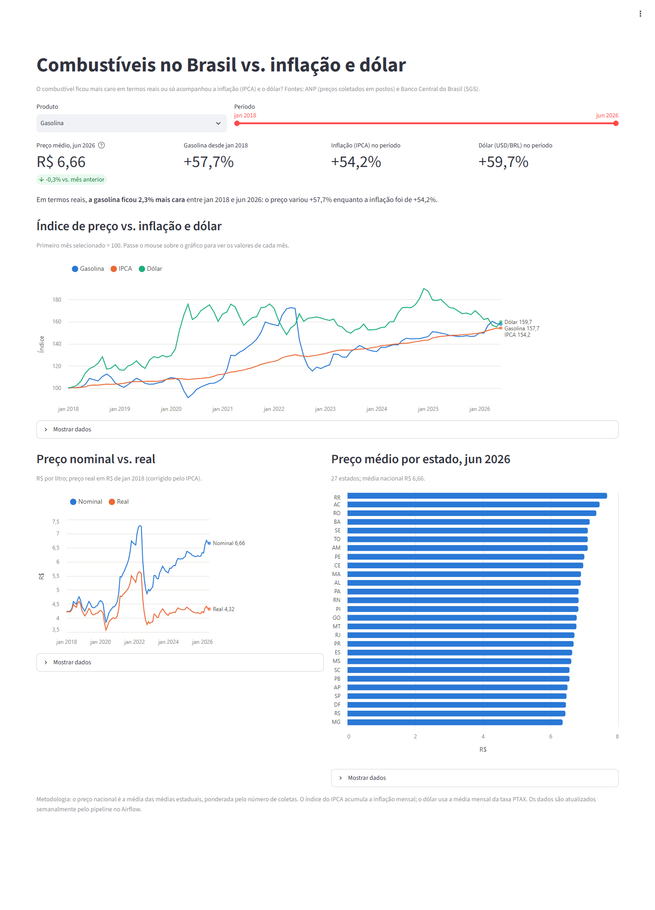
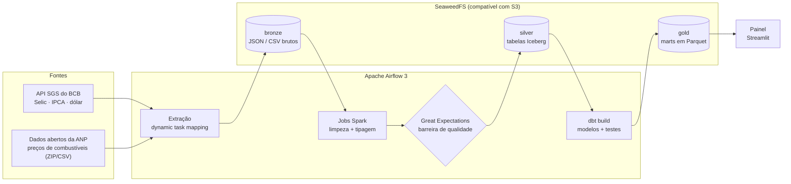
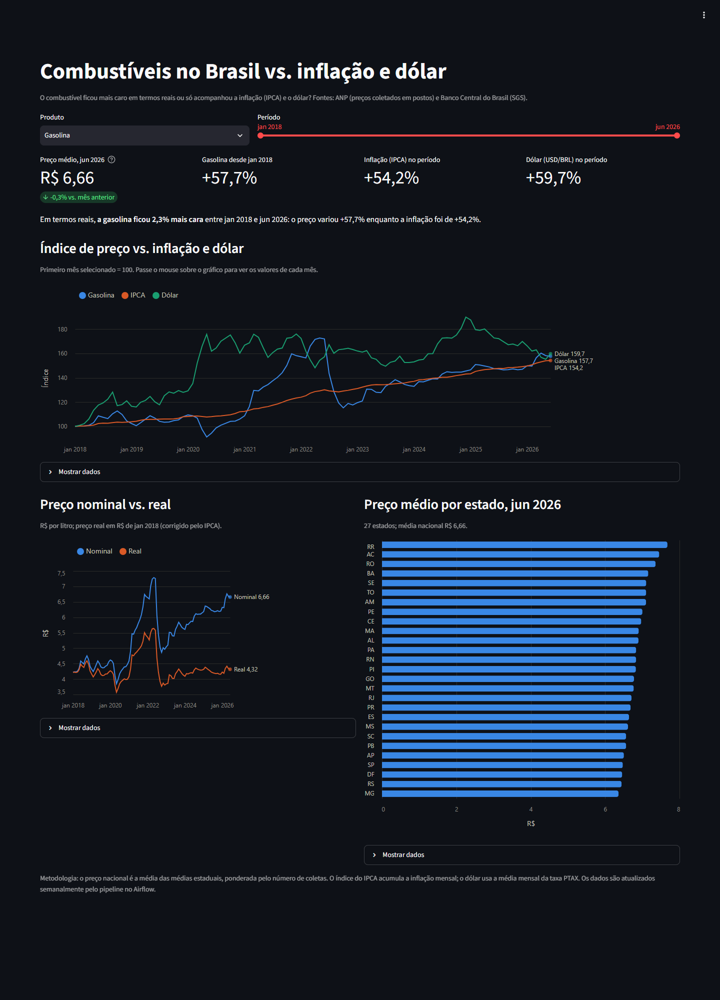
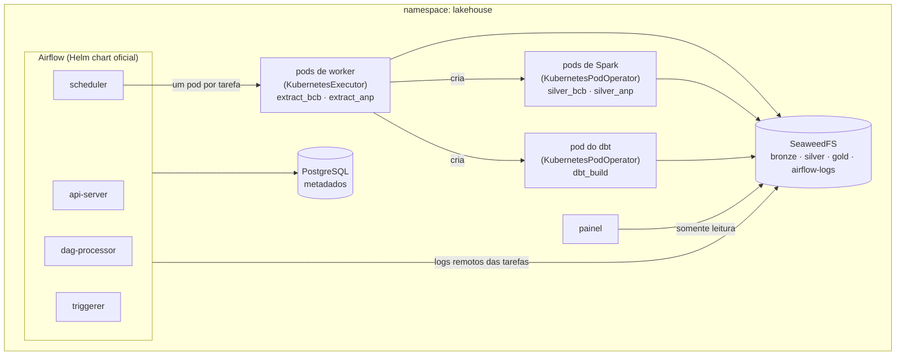

# 🇧🇷 Brazil Economic Data Lakehouse

🇺🇸 [English version](README.en.md)


Uma plataforma de dados em lote, de ponta a ponta, que coleta indicadores econômicos e preços de combustíveis de fontes públicas brasileiras, organiza tudo numa **arquitetura medallion** (bronze → silver → gold) em um data lake compatível com S3, processa os dados com **Apache Spark** em tabelas **Apache Iceberg** protegidas por validações do **Great Expectations**, modela tabelas analíticas com **dbt** e entrega o resultado num painel em **Streamlit**. Tudo é orquestrado pelo **Apache Airflow** e roda com **Docker Compose** ou no **Kubernetes** (Helm chart oficial, um pod por tarefa).



## Pergunta de negócio

> Como os preços dos combustíveis no Brasil evoluíram em comparação com a inflação (IPCA), o dólar e a taxa Selic?

O mart final coloca todos os indicadores em base 100 no primeiro mês do período, o que deixa fácil ver se o combustível ficou mais caro em termos reais ou só acompanhou a inflação e o dólar.

## Principais conclusões

De janeiro de 2018 a junho de 2026, médias nacionais calculadas a partir de **7,4 milhões** de preços coletados pela ANP:

| Produto | Jan 2018 | Jun 2026 | Variação nominal | Variação real (corrigida pelo IPCA) |
|---|---|---|---|---|
| Diesel S10 | R$ 3,49 / l | R$ 7,12 / l | +104,1% | **+32,3%** |
| Diesel | R$ 3,39 / l | R$ 6,87 / l | +102,5% | +31,3% |
| GNV | R$ 2,48 / m³ | R$ 4,67 / m³ | +88,1% | +22,0% |
| Gasolina | R$ 4,22 / l | R$ 6,66 / l | +57,7% | +2,3% |
| Etanol | R$ 3,14 / l | R$ 4,45 / l | +41,4% | **−8,3%** |
| Gasolina aditivada¹ | R$ 4,55 / l | R$ 6,86 / l | +50,8% | +7,2% |

¹ A ANP só traz a gasolina aditivada a partir de outubro de 2020, então a comparação dela começa ali.

No mesmo período, a inflação (IPCA) acumulou +54,2% e o dólar subiu +59,7%.

- **O diesel dobrou de preço e ficou cerca de 31% mais caro em termos reais**, acompanhando mais o dólar (+59,7%) do que a inflação.
- **A gasolina praticamente acompanhou a inflação** no período todo (+2,3% em termos reais), mas o caminho foi tudo menos estável: de R$ 3,85 em maio de 2020, no fundo da pandemia, a R$ 7,29 em maio de 2022.
- **O etanol foi o único combustível que ficou mais barato em termos reais.**
- **A diferença entre os estados é grande**: em junho de 2026 a gasolina custava R$ 7,68 em Roraima e R$ 6,36 em Minas Gerais (+21%); o etanol ia de R$ 3,86 (Mato Grosso) a R$ 5,89 (Amapá).

## Arquitetura



## Tecnologias

| Camada | Tecnologia |
|---|---|
| Orquestração | Apache Airflow 3.3 (TaskFlow API; LocalExecutor no Compose, KubernetesExecutor no Kubernetes) |
| Ingestão | Python 3.12, Requests, boto3 |
| Transformação (bronze → silver) | Apache Spark 4.1 (PySpark) |
| Data lake | SeaweedFS (API S3), Apache Iceberg 1.12 |
| Engenharia analítica | dbt-core + dbt-duckdb (o DuckDB lê o Iceberg e os marts são exportados como Parquet) |
| Qualidade de dados | Great Expectations (barreira que bloqueia antes da silver), testes do dbt |
| Visualização | Streamlit + Altair |
| Infraestrutura | Docker Compose; Kubernetes (kind), Helm chart oficial do Airflow, Kustomize |
| CI | GitHub Actions: Ruff, pytest, testes de Spark no Java 17, dbt parse, validação dos manifestos do Kubernetes |

## Fontes de dados

| Fonte | Conjunto de dados | Frequência | Acesso |
|---|---|---|---|
| [Banco Central do Brasil — SGS](https://dadosabertos.bcb.gov.br/) | Meta da taxa Selic (série 432) | Diária | API REST pública |
| [Banco Central do Brasil — SGS](https://dadosabertos.bcb.gov.br/) | IPCA mensal (série 433) | Mensal | API REST pública |
| [Banco Central do Brasil — SGS](https://dadosabertos.bcb.gov.br/) | Dólar comercial, PTAX (série 1) | Diária | API REST pública |
| [ANP — Série Histórica de Preços de Combustíveis](https://www.gov.br/anp/pt-br/centrais-de-conteudo/dados-abertos/serie-historica-de-precos-de-combustiveis) | Preços coletados em postos de combustíveis | Arquivos semestrais | ZIP / CSV públicos |

Nenhuma chave de API é necessária.

## Camadas de dados

| Camada | Armazenamento | Conteúdo |
|---|---|---|
| **Bronze** | `s3://bronze/` | Dados brutos como chegaram, particionados por fonte e período de ingestão: JSON do BCB e o CSV da ANP byte a byte, compactado em gzip (a ANP publica arquivos ZIP, que o Spark não lê) |
| **Silver** | `s3://silver/warehouse/` | Tabelas Iceberg limpas, tipadas e sem duplicatas, gravadas pelo Spark só depois de passar pela barreira de qualidade |
| **Gold** | `s3://gold/marts/` | Marts do dbt exportados como Parquet e lidos pelo painel. Os modelos de staging e intermediate ficam no DuckDB |

### Tabelas da silver (Iceberg)

| Tabela | Particionamento | Gravada por |
|---|---|---|
| `lake.bcb.series` | `series_name` | `lakehouse.spark.bcb_silver` (snapshot mais recente de cada série na bronze) |
| `lake.anp.fuel_prices` | `period_year`, `period_semester` | `lakehouse.spark.anp_silver` (uma partição por arquivo semestral da bronze) |

As duas tabelas têm colunas de linhagem: `_source_file` (o objeto da bronze de onde a linha veio) e `_ingested_at`.

### Qualidade de dados

A qualidade é verificada em dois pontos:

1. **Antes da silver (Great Expectations, bloqueante).** Cada job Spark valida o DataFrame antes de gravar. Se alguma expectativa falha, a tarefa falha e nada é gravado, então dados ruins nunca chegam à silver. As verificações incluem contagem de linhas, chaves não nulas, siglas de estado válidas, tamanho do CNPJ, datas únicas por série do BCB e faixas de valor plausíveis (por exemplo, dólar entre 0,5 e 20 e combustível entre R$ 0,50 e R$ 50).
2. **Na gold (testes do dbt).** O dbt verifica unicidade, colunas não nulas, valores aceitos e limites de preço nos modelos.

### Modelos da gold

| Modelo | Granularidade | Descrição |
|---|---|---|
| `staging.stg_bcb__series` | série × data | Séries do BCB padronizadas |
| `staging.stg_anp__fuel_prices` | coleta de preço | Coletas da ANP padronizadas |
| `intermediate.int_macro_indicators_monthly` | mês | Selic, IPCA e dólar em granularidade mensal |
| `marts.fct_fuel_prices_monthly` | mês × estado × produto | Preço médio, mediano, mínimo e máximo |
| `marts.mart_fuel_vs_macro` | mês × produto | Preços nacionais vs. indicadores macroeconômicos em base 100, mais o preço corrigido pela inflação |

## Pipeline

A DAG `economic_lakehouse` roda semanalmente:

```
list_bcb_series ──► extract_bcb[n] ──► silver_bcb (Spark) ──┐
                                                            ├──► dbt_build
list_anp_periods ─► extract_anp[n] ──► silver_anp (Spark) ──┘
```

- **Dynamic task mapping** cria uma tarefa de extração por série do BCB e uma por semestre da ANP.
- **Idempotente por construção**: arquivos da ANP que já estão na bronze não são baixados de novo. O Spark só processa semestres que ainda não estão na silver (consultando os metadados de partição do Iceberg, sem ler os dados) e grava com sobrescrita dinâmica de partições, então uma reexecução substitui as próprias partições em vez de duplicar linhas. O parâmetro `full_refresh` reconstrói todas as partições.
- **Uma DAG, dois ambientes**: no Docker Compose, Spark e dbt rodam dentro do worker do Airflow (`BashOperator`, Spark local e um pool de uma vaga para limitar a memória). No Kubernetes (`LAKEHOUSE_RUNTIME=kubernetes`) eles rodam em pods com imagens próprias (`KubernetesPodOperator`), com requests e limites de memória.
- **Dados ainda não publicados não quebram o pipeline**: se o arquivo da ANP do semestre atual ainda não saiu, a tarefa é *pulada* em vez de falhar, e o `dbt_build` roda mesmo assim (`trigger_rule="none_failed"`).
- **Novas tentativas** com espera crescente, tanto no cliente HTTP quanto nas tarefas do Airflow.

## Painel

O app em Streamlit lê os marts da gold em Parquet com uma identidade S3 **somente leitura**. Uma única linha de filtros (produto e período) controla tudo:

- Indicadores: preço nacional mais recente, variação desde o início do período, IPCA acumulado e variação do dólar, mais uma frase resumindo a variação real do preço.
- Índice do preço do combustível vs. IPCA vs. dólar num único eixo (todos em base 100 no primeiro mês selecionado), com rótulos diretos e tooltip ao passar o mouse.
- Preço nominal vs. real (corrigido pelo IPCA) e preço médio por estado no último mês.
- Todo gráfico tem uma tabela em "Mostrar dados". As cores vêm de uma paleta validada para daltonismo, com versões para o modo claro e o escuro. Datas e números seguem o formato brasileiro (`jan 2018`, `R$ 6,66`).

| Claro | Escuro |
|---|---|
|  |  |

## Como rodar

### Opção 1: Docker Compose

Pré-requisitos: Docker com pelo menos 6 GB de RAM, cerca de 8 GB de disco para as imagens e `make`.

```bash
git clone https://github.com/<seu-usuario>/brazil-economic-lakehouse.git
cd brazil-economic-lakehouse

make up          # cria o .env com segredos aleatórios, gera as imagens e sobe todos os serviços
make trigger     # ativa e dispara a DAG
make dashboard   # mostra o endereço do painel
```

Sem `make`:

```bash
cp .env.example .env
chmod 600 .env
# troque cada "change-me" do .env por um valor aleatório, por exemplo `openssl rand -hex 32`
docker compose up -d --build
```

| Serviço | Endereço | Credenciais |
|---|---|---|
| Interface do Airflow | http://localhost:8080 (`AIRFLOW_PORT`) | Usuário `admin`; a senha é gerada na primeira subida em `config/simple_auth_manager_passwords.json.generated` |
| Painel | http://localhost:8501 (`DASHBOARD_PORT`) | — |
| API S3 (SeaweedFS) | http://localhost:8333 | Chaves de admin do `.env` (`S3_ADMIN_ACCESS_KEY` / `S3_ADMIN_SECRET_KEY`), para usar com a AWS CLI ou qualquer cliente S3 |

Todas as portas escutam só em `127.0.0.1`, então nada fica acessível a outras máquinas da rede.

### Opção 2: Kubernetes (kind + Helm)

Pré-requisitos: Docker com pelo menos 8 GB de RAM, [kind](https://kind.sigs.k8s.io/), `kubectl`, [Helm](https://helm.sh/) e `make`.

```bash
make k8s-up          # cluster kind, imagens, Secrets a partir do .env, serviços de plataforma e Airflow via Helm
make k8s-trigger     # ativa e dispara a DAG
make k8s-airflow     # port-forward da interface do Airflow para http://localhost:8080 (senha: make k8s-password)
make k8s-dashboard   # port-forward do painel para http://localhost:8501
make k8s-down        # apaga o cluster
```



O que muda em relação ao Compose:

- **Cada tarefa roda no próprio pod.** As extrações rodam em pods de worker (KubernetesExecutor). Spark e dbt rodam em pods com imagens dedicadas (`docker/spark`, `docker/dbt`), com requests e limites de memória, então é o Kubernetes, e não um pool do Airflow, que decide onde eles cabem.
- **dbt sem estado.** O arquivo do DuckDB fica no `/tmp` do pod: a staging é reconstruída a partir da silver a cada execução e os marts são exportados para o bucket gold, então nenhum volume compartilhado é necessário.
- **Logs remotos.** Os pods das tarefas são apagados ao terminar, então o Airflow grava os logs no bucket `airflow-logs`, com uma identidade S3 que só acessa esse bucket.
- **Secrets a partir do `.env`.** O `k8s/create-secrets.sh` transforma o `.env` em Secrets do Kubernetes, então nenhuma credencial é commitada. Cada workload recebe só a própria identidade, e a chave Fernet e a senha do admin são geradas uma única vez e mantidas nas reexecuções.
- **DAGs embutidas na imagem.** O target `kubernetes` do `docker/airflow/Dockerfile` copia as DAGs e o pacote `lakehouse`, então todos os pods rodam a mesma versão do código.

### Configuração

| Variável | Padrão | Descrição |
|---|---|---|
| `PIPELINE_START_YEAR` | `2018` | Primeiro ano a coletar. Anos mais antigos significam downloads maiores da ANP |
| `ANP_URL_TEMPLATE` | URL dos arquivos semestrais da ANP | Troque se a ANP mudar o local dos arquivos. Marcadores: `{year}`, `{semester}` e `{ext}`; `zip` é tentado primeiro, depois `csv`. Semestres publicados fora do padrão (2022-S1) ficam em `ANP_URL_OVERRIDES`, no `config.py` |
| `ANP_MAX_DOWNLOAD_MB` | `1024` | Tamanho máximo de um arquivo da ANP (download e CSV descompactado); arquivos maiores são abortados. Os arquivos vão para o disco em streaming, sem ficar inteiros na memória |
| `AIRFLOW_PORT` / `DASHBOARD_PORT` | `8080` / `8501` | Portas no host no Docker Compose |
| `AIRFLOW_UID` | seu id de usuário | Evita problemas de permissão nos bind mounts no Linux |

## Consultando os resultados

```bash
make query
```

Ou leia os marts da gold com qualquer cliente DuckDB (com um secret S3 apontando para o SeaweedFS):

```sql
select month, product, avg_price, real_avg_price, fuel_price_index, ipca_index, usd_brl_index
from 's3://gold/marts/mart_fuel_vs_macro.parquet'
where product = 'GASOLINA'
order by month;
```

## Segurança

| Área | Medida |
|---|---|
| Object storage | Quatro identidades S3 com menor privilégio: **admin** (pessoas), **pipeline** (bronze, silver e gold), **dashboard** (somente leitura na gold) e **logs** (só no Kubernetes, `airflow-logs`). Nenhum workload usa as chaves de admin |
| Segredos | Valores aleatórios gerados pelo `make init` num `.env` com permissão 600 (ignorado pelo git e fora dos contextos de build do Docker); os Secrets do Kubernetes são criados a partir dele, nunca commitados |
| Rede | Portas do Compose só em `127.0.0.1`; serviços do Kubernetes só como `ClusterIP` (acesso via port-forward). As portas de master, volume e filer do SeaweedFS, que não têm autenticação, nunca são expostas |
| Airflow | Login obrigatório (simple auth manager), com chaves JWT e de API separadas |
| Contêineres | Nada roda como root; no Kubernetes os pods também descartam todas as capabilities, bloqueiam escalada de privilégio e usam o perfil seccomp `RuntimeDefault` (o namespace avisa sobre qualquer pod abaixo do perfil `restricted` do Pod Security) |
| Cadeia de suprimentos | Versões fixadas; jars do Iceberg e do S3A conferidos contra checksums SHA-256 fixados no build |
| Ingestão | Downloads e conteúdo de ZIP com limite de tamanho aplicado durante a leitura (proteção contra zip bomb), arquivos com exatamente um CSV, e downloads retomados conferidos contra a posição esperada e o tamanho total |
| Privacidade | Telemetria desligada no Great Expectations, no dbt e no Streamlit |

## Testes

```bash
pip install -r requirements-dev.txt
make test         # testes unitários da extração (não precisa de Java)
make test-spark   # transformações do Spark e barreiras de qualidade, rodando dentro da imagem do Airflow
make lint         # ruff
```

O CI também roda os testes de Spark no Java 17, o `dbt parse` e valida os manifestos do Kubernetes e o Helm chart com os values deste projeto. Os testes do dbt rodam automaticamente no `dbt build` dentro da DAG.

## Estrutura do projeto

```
brazil-economic-lakehouse/
├── dags/
│   └── economic_lakehouse.py       # DAG do Airflow (ambientes Compose e Kubernetes)
├── src/lakehouse/
│   ├── sources/
│   │   ├── bcb.py                  # cliente da API SGS do BCB
│   │   └── anp.py                  # download da ANP (ZIP/CSV, em streaming, com limite e retomada)
│   ├── spark/
│   │   ├── session.py              # SparkSession com Iceberg + S3A
│   │   ├── quality.py              # barreira de qualidade com Great Expectations
│   │   ├── bcb_silver.py           # job bronze -> silver do BCB
│   │   └── anp_silver.py           # job bronze -> silver da ANP
│   ├── jobs.py                     # jobs de extração usados pela DAG
│   ├── storage.py                  # acesso ao S3 (boto3)
│   ├── http.py                     # sessão HTTP com novas tentativas
│   ├── config.py
│   └── exceptions.py
├── dbt_project/                    # staging -> intermediate -> marts (exportados para a gold)
├── dashboard/                      # app em Streamlit
├── k8s/
│   ├── base/                       # namespace, PostgreSQL, SeaweedFS, painel (Kustomize)
│   ├── airflow-values.yaml         # values do Helm chart oficial do Airflow
│   ├── create-secrets.sh           # Secrets do Kubernetes a partir do .env
│   └── kind-config.yaml
├── docker/
│   ├── airflow/                    # imagem do Airflow: targets "compose" e "kubernetes"
│   ├── spark/                      # imagem dos jobs Spark + download dos jars com checksum
│   ├── dbt/                        # imagem do dbt
│   ├── dashboard/                  # imagem do painel
│   └── seaweedfs/                  # identidades S3 e criação dos buckets
├── tests/                          # testes unitários com pytest + fixtures
│   └── spark/                      # testes de Spark e de qualidade de dados
├── docs/images/                    # capturas de tela do painel
├── .github/workflows/ci.yml
├── docker-compose.yml
├── Makefile
├── README.md
└── README.en.md                    # versão em inglês
```

## Decisões técnicas

- **A regra de negócio fica fora da DAG.** A DAG só orquestra; extração e transformação ficam no pacote `lakehouse`, que não depende do Airflow e pode ser testado isoladamente.
- **Spark para bronze → silver.** Os arquivos da ANP têm milhões de linhas por semestre. O Spark permite escalar além da memória de uma máquina, e o mesmo código roda localmente no Compose e em pods no Kubernetes.
- **Iceberg em vez de Parquet puro.** Pastas de Parquet não têm transações: um job que falha pode deixar arquivos pela metade que os leitores acabam lendo, e substituir um semestre exige apagar arquivos à mão. O Iceberg acrescenta commits atômicos, evolução de schema, sobrescrita de partições e time travel (`VERSION AS OF`) sobre os mesmos arquivos Parquet.
- **Catálogo Hadoop no object storage.** O catálogo do Iceberg é só um conjunto de arquivos no object storage, então nenhum serviço extra é necessário e o DuckDB lê as tabelas com `iceberg_scan`. A contrapartida é que os commits dependem de renames não atômicos, então só é seguro com um escritor por tabela. Isso vale aqui por causa do `max_active_runs=1` e de um único job Spark por tabela. Em produção, o caminho seria um catálogo REST (o próprio SeaweedFS tem um; Apache Polaris e Lakekeeper são alternativas) ou o AWS Glue.
- **Partição da ANP pelo período de origem, e não por mês.** Cada arquivo da bronze vira exatamente uma partição, então reprocessar um arquivo nunca sobrescreve dados de outro, mesmo que um arquivo traga alguma linha perdida de outro mês.
- **Barreira de qualidade antes de gravar.** O Great Expectations roda dentro do job Spark, sobre o DataFrame que está prestes a ser gravado, então a silver só tem dados validados. Os testes do dbt são uma segunda linha de defesa na gold.
- **Marts da gold exportados para o object storage.** O dbt grava os marts como Parquet no bucket gold. O painel nunca toca o arquivo do DuckDB (que fica travado enquanto o dbt grava e não pode ser compartilhado entre pods), e o próprio dbt fica sem estado no Kubernetes.
- **Uma imagem por workload no Kubernetes.** Airflow, Spark, dbt e o painel têm imagens e dependências próprias. No Compose, uma única imagem do Airflow com virtualenvs isolados mantém a configuração simples.
- **PostgreSQL próprio em vez do chart.** O chart do Airflow traz uma imagem PostgreSQL da Bitnami que foi descontinuada, então o banco de metadados é um deployment simples com `postgres:16`.
- **Job de migração sem hooks do Helm.** Com `helm --wait`, um hook post-install só roda depois que todos os pods ficam prontos, enquanto os pods do Airflow esperam a migração: um deadlock. Rodar a migração como um Job comum resolve.
- **Mesmo modelo de login no Compose e no Kubernetes.** O Helm chart usa o FAB auth manager por padrão; aqui ele é trocado pelo simple auth manager do Airflow 3, com a senha do admin vinda de um Secret. O Airflow abre o arquivo de senhas para leitura e escrita, e volumes de Secret são somente leitura, então um init container copia o arquivo para um `emptyDir` em memória.
- **Limites dimensionados a partir de falhas reais.** Num cluster de um nó, os valores padrão reiniciavam o API server durante a subida (probe curta demais) e o triggerer era encerrado por falta de memória (OOMKilled) com 512 Mi. Os dois limites vieram da observação dessas falhas, e não de chute.
- **SeaweedFS em vez de MinIO.** O projeto começou com MinIO, mas o MinIO arquivou o repositório da versão comunitária e removeu as imagens Docker, então ele não recebe mais correções de segurança. O SeaweedFS tem licença Apache 2.0, é mantido ativamente e permite permissões por bucket para cada identidade, o que preserva a configuração de menor privilégio.
- **O DuckDB lê o Iceberg direto do object storage**, pelas extensões `iceberg` e `httpfs`, então a silver nunca é copiada para o warehouse antes da modelagem.
- **Downloads com retomada.** O servidor da ANP derruba no meio as transferências longas dos CSVs antigos, sem compactação (cerca de 87 MB, de 2018 a 2021), todas as vezes. Recomeçar do zero não adianta, então o download continua a partir do último byte gravado com HTTP `Range`, confere se o servidor retomou na posição certa e verifica o tamanho final.
- **Peculiaridades da fonte ficam explícitas.** A ANP trocou CSV por ZIP em 2022 e publicou o 1º semestre de 2022 com outro nome de arquivo. Os formatos são tentados em ordem, e as exceções ao padrão de nome ficam numa tabela pequena e documentada, em vez de serem adivinhadas.
- **A bronze é imutável.** Os dados brutos são guardados como chegaram, então qualquer tabela da silver ou da gold pode ser reconstruída sem consultar as fontes de novo.

## Próximos passos

- [x] **Fase 1** — Airflow + data lake compatível com S3 + ingestão em Python + dbt, rodando com Docker Compose
- [x] **Fase 2** — Apache Spark na passagem bronze → silver, tabelas Apache Iceberg, Great Expectations
- [x] **Fase 3** — Kubernetes com o Helm chart oficial do Airflow, KubernetesExecutor e `KubernetesPodOperator`
- [x] Painel (Streamlit)
- [ ] Catálogo REST do Iceberg (SeaweedFS) no lugar do catálogo Hadoop
- [ ] Gerar e publicar as imagens no CI (GHCR), com verificação de vulnerabilidades
- [ ] NetworkPolicies (exige um CNI que as aplique, como Calico ou Cilium)

## Licença

MIT
